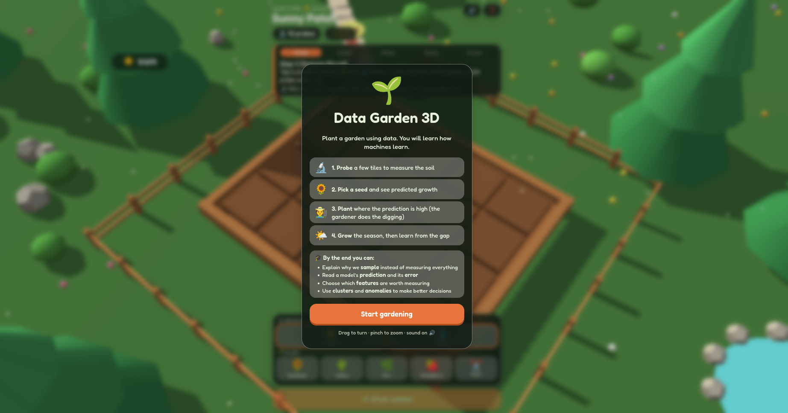
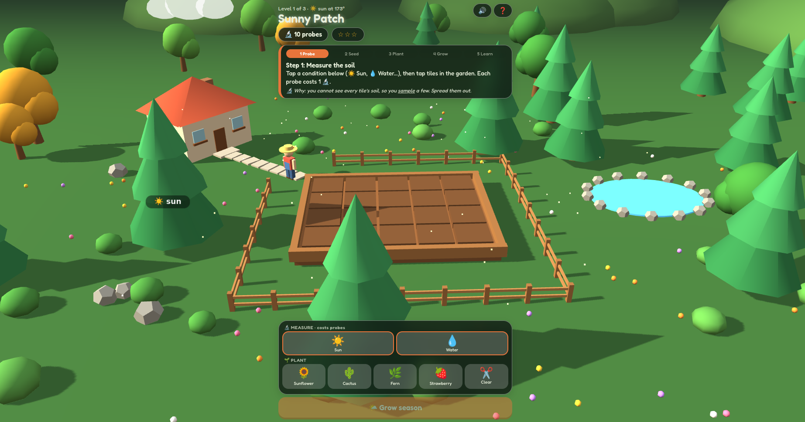
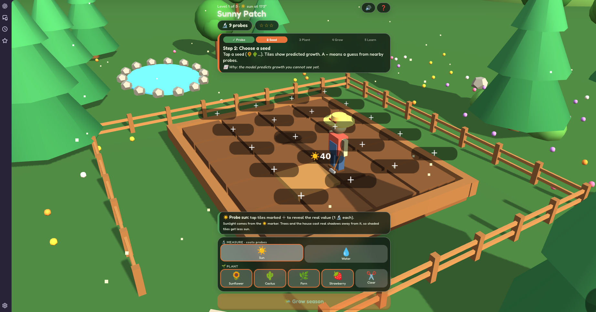
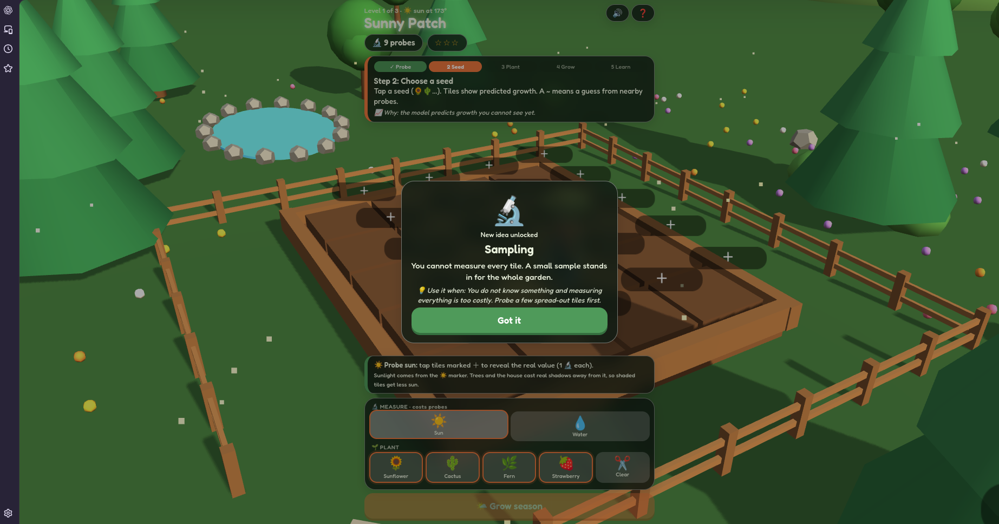
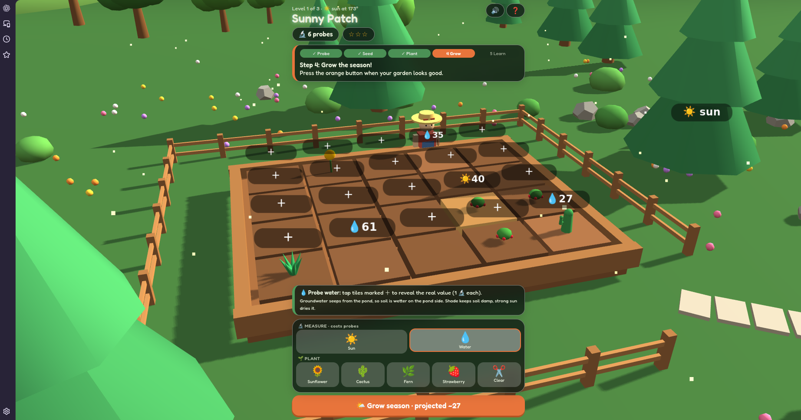
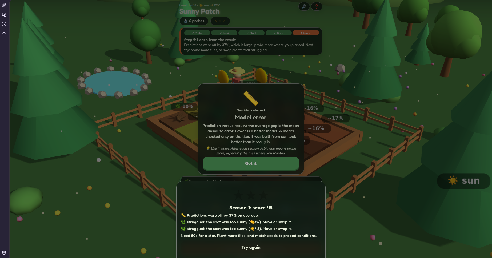

# Data Garden 3D

**Plant a garden with data. Learn sampling, prediction, error, features, clusters and anomalies.**

Data Garden 3D is an interactive 3D educational game that runs in the browser. You play a gardener who cannot see the soil. You measure a few tiles, use the numbers to predict how well each plant will grow, plant, grow a season, and then compare your predictions with what actually happened. The loop mirrors how data scientists work, so the ideas can be *seen* instead of memorised.

**Play it:** [tranquil-cactus-2d93a6.netlify.app](https://tranquil-cactus-2d93a6.netlify.app)










---

## What you learn

| Concept | How it appears in the game |
|---|---|
| **Sampling** | A limited probe budget forces you to measure only some tiles |
| **Prediction (regression-style)** | Each tile shows a predicted growth % for the selected seed |
| **Model error (MAE)** | After a season, the game reports the average gap between predicted and actual growth |
| **Feature selection** | Each seed's green band shows which soil conditions matter, so you can skip useless probes |
| **Clustering (k-means)** | Plants are grouped by their preferences (coloured rings); same-group neighbours grow better |
| **Anomaly detection** | Level 3 hides odd tiles; plants that grow far better or worse than predicted are flagged |

> **This is a teaching simulation, not real machine learning.** No model is trained and no real dataset is used. See [How it works](#how-it-works).

---

## Quick start

1. Open the game (link above, or run it locally, see [Running locally](#running-locally)).
2. Press **Start gardening**.
3. In the **Measure** row, tap **Sun**, then tap about five tiles marked `+`, spread out. Repeat with **Water**.
4. In the **Plant** row, tap a seed and read the percentage on each tile. A `~` means the game is guessing from nearby probes.
5. Tap tiles with high percentages to plant. The gardener does the digging.
6. Fill the garden, then press **Grow season**.
7. Read the result sheet. Choose **Keep tweaking** to swap plants, or **Next level** once you have at least one star.

Tap the **?** button at any time for the in-game *How to play* panel.

### The gameplay loop

**Probe → Select seed → Predict → Plant → Grow → Learn**

(The in-game coach shows five steps: Probe, Seed, Plant, Grow, Learn. "Predict" is part of the Seed step.)

### Controls

| Action | Mouse | Touch |
|---|---|---|
| Turn the garden | Click and drag | Drag with one finger |
| Zoom | Scroll wheel | Pinch with two fingers |
| Use a tool on a tile | Click the tile | Tap the tile |
| Sound / help | Speaker and **?** buttons, top right | same |
| Hide or show coach text | Click the coach panel | Tap the coach panel |

---

## Levels

| | 1. Sunny Patch | 2. Wild Corner | 3. Mystery Meadow |
|---|---|---|---|
| Grid | 5 × 4 (20 tiles) | 5 × 5 (25 tiles) | 5 × 5 (25 tiles) |
| Soil conditions | Sun, Water | + Soil pH | + Warmth |
| Plants | Sunflower, Cactus, Fern, Strawberry | + Lavender | + Mushroom |
| Probes | 10 | 14 | 16 |
| New ideas | Sampling, prediction, model error | Feature selection, clustering | Anomaly detection |
| Special | Basic loop | Coloured plant-family rings; same-group neighbours grow 7% better | Three hidden odd tiles (blooms and blights) |

Score thresholds on every level: **50+** for one star, **70+** for two, **85+** for three (nine stars in total). One star unlocks the next level.

---

## Soil and plants

Each tile has up to four conditions on a 0–100 scale:

- **Sun**: trees and the house cast shadows away from the sun marker.
- **Water**: groundwater seeps from the pond; shade keeps soil damp, strong sun dries it.
- **Soil pH**: wet soil turns acidic; pines acidify nearby ground.
- **Warmth**: follows the sun; wet soil stays cooler.

The sun direction is **random on every page load**, so the pattern of shady, wet and acidic tiles changes between visits.

Six plants appear (Sunflower, Cactus, Fern, Strawberry, Lavender, Mushroom). Each has preferred conditions and a tolerance, shown in-game as a green band. Plant preferences are simplified values set by the author for teaching and are not agricultural data.

---

## How it works

Everything below is taken from the source code (`Data_Garden_3D.html`).

- **Soil:** each tile's true conditions come from simple physical rules (sun elevation and shadows from the trees and house, wetness from the pond, acidity from pines, small noise).
- **Prediction:** for a seed, predicted growth is a hand-written Gaussian suitability function: the geometric mean of `exp(-0.5 z²)` over the conditions, where `z = (value − ideal) / tolerance`. Conditions you have not measured are estimated by inverse-distance weighting (`1/d²`) of probed tiles, or 0.5 if nothing is probed. Fully measured tiles show an exact value; others are marked `~`.
- **Actual growth:** the same suitability function applied to the *true* conditions, plus a neighbour bonus (levels 2–3), any hidden anomaly offset, and uniform random noise of ±0.05.
- **Model error:** mean absolute error between predicted and actual growth over planted tiles, excluding tiles flagged as anomalies.
- **Clustering:** k-means (k = 3, nine iterations) runs on the six plants' preference vectors. Result: {Sunflower, Strawberry}, {Fern, Mushroom}, {Cactus, Lavender}. Each adjacent (up/down/left/right) planted tile in the same cluster adds 7% to a plant's growth.
- **Anomalies:** on level 3, three tiles carry hidden offsets (two blooms of +0.45, one blight of −0.5). After a season, a planted hidden-anomaly tile is flagged when its residual deviates from the median residual by more than `max(0.15, 3 × (1.48·MAD + 0.03))`.
- **Score:** `min(100, round(100 × Σgrowth / (0.6 × tiles) × (0.9 + 0.025 × kinds)))`, where `kinds` is the number of different seeds planted (capped at 4). Empty tiles add zero.

### What is simplified

- No model is trained, there is no train/test split, and no real dataset is used.
- The "true" growth shares the plant preferences with the prediction, so prediction error mostly reflects what you did *not* measure, plus noise, the neighbour bonus and anomalies.
- Clustering runs on only six hand-defined points.
- Anomaly flagging is applied only to the tiles the game hides anomalies on.

---

## Running locally

The game is a single HTML file with no build step.

```bash
git clone "https://github.com/Gowtham13042007/Garden3D_Game.git"
cd Garden3D_Game

# Option 1: open the file directly
open Data_Garden_3D.html          # macOS; on Linux use xdg-open, on Windows just double-click

# Option 2: serve it locally
python3 -m http.server 8000       # then visit http://localhost:8000/Data_Garden_3D.html
```

**Requirements**

- A modern browser with **WebGL** enabled (if you see "3D garden unavailable", enable hardware acceleration or try another browser).
- An **internet connection**: Three.js (r128) is loaded from cdnjs and the Fredoka font from Google Fonts. To run offline, download `three.min.js` (r128) and change the `<script src>` in the HTML to the local file.

---

## Tech stack

- HTML, CSS and vanilla JavaScript in one file
- [Three.js](https://threejs.org/) r128 (WebGL) for the 3D garden
- Web Audio API for sound, Vibration API for haptics on supported devices
- Light and dark themes via `prefers-color-scheme`

---

## Project structure

```
.
├── Data_Garden_3D.html     # the whole game
├── README.md
└── docs/
    ├── images/             # screenshots (add your own)
    └── Data_Garden_3D_Report.pdf   # player guide and learning report
    └── Data_Garden_3D_Playtester_Feedback.csv   # Feedback from payers with their scores
```


## Limitations and future work

**Limitations**

- Six plants and four soil conditions only.
- Results vary between sessions (random sun direction and season noise).
- Requires internet for the 3D library and font unless bundled.
- No formal user study or learning evaluation has been done, so there are no claims about how much players learn.

**Possible improvements**

- Real datasets and genuinely fitted regression models with a train/test split
- More plants, soil conditions and levels
- Automatic anomaly detection on every tile
- Bundling assets for offline play
- Playtesting with real learners and pre/post assessment

---

## Credits

Built by Gowtham Papani ,Monish Kumar ,Varshith as a project for the IDSE course at the Indian Institute of Information Technology, Design and Manufacturing, Kancheepuram.

